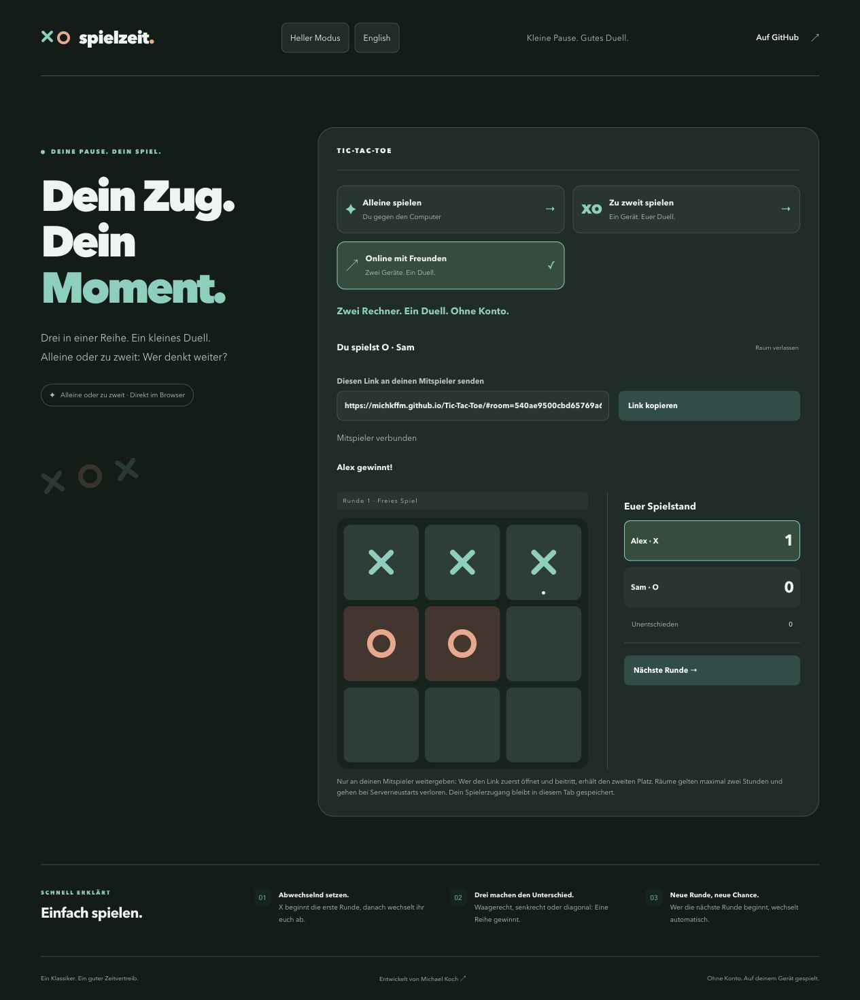

# Spielzeit · Tic-Tac-Toe

Ein Fullstack-Browserspiel mit Angular, TypeScript und Flask. Spiele gegen den Computer, gemeinsam an einem Gerät oder online mit einem Freund auf einem anderen Gerät.

**[Live-Demo öffnen](https://michkffm.github.io/Tic-Tac-Toe/)**



## Funktionen

- **Einzelspieler:** Drei Schwierigkeitsstufen mit einem Minimax-Computergegner auf der höchsten Stufe.
- **Lokaler Mehrspieler:** Zwei Spieler an einem Gerät mit eigenen Namen.
- **Online-Mehrspieler:** Private Spielräume mit Einladungslink für zwei Geräte.
- **Match-System:** Punkte, Rundenwechsel und optional ein Match bis drei Siege.
- **Darstellung:** Hell- und Dunkelmodus, Deutsch und Englisch sowie hervorgehobene Gewinnlinien.
- **Spielstände:** Optionale manuelle Speicherung lokaler Partien über das SQLite-Backend.

## Technologien

| Bereich | Technologien |
| --- | --- |
| Frontend | Angular 20, TypeScript, CSS |
| Backend | Python 3.13, Flask, Gunicorn |
| Datenhaltung | SQLite für lokale Speicherstände, Arbeitsspeicher für Online-Räume |
| Tests | Jasmine, Karma, ChromeHeadless, Python unittest |
| Deployment | GitHub Actions, GitHub Pages, Render |

## Technische Umsetzung

Die lokalen Spielmodi laufen im Browser. Der Computergegner verwendet auf der höchsten Schwierigkeitsstufe den **Minimax-Algorithmus**, um mögliche Spielverläufe auszuwerten und den besten Zug zu bestimmen.

Für Online-Partien kommuniziert das Angular-Frontend über eine selbst entwickelte **HTTP-API mit JSON** mit dem Flask-Backend. Der Server verwaltet Räume und Spielerrechte, validiert Züge und berechnet Ergebnisse. Das Frontend fragt den gemeinsamen Spielstand alle vier Sekunden ab. Revisionsnummern schützen vor dem Überschreiben durch veraltete Anfragen.

Die wichtigsten API-Endpunkte:

| Methode | Endpunkt | Funktion |
| --- | --- | --- |
| `POST` | `/api/rooms` | Spielraum erstellen |
| `POST` | `/api/rooms/{roomId}/join` | Einem Spielraum beitreten |
| `GET` | `/api/rooms/{roomId}` | Spielstand abrufen |
| `POST` | `/api/rooms/{roomId}/move` | Spielzug ausführen |
| `POST` | `/api/rooms/{roomId}/round` | Nächste Runde starten |

Spielerzugänge werden getrennt vom Einladungslink im jeweiligen Browser-Tab gespeichert und über Authorization-Header übertragen. Eingaben und Berechtigungen werden serverseitig geprüft.

## Online spielen

1. Die [Live-Demo](https://michkffm.github.io/Tic-Tac-Toe/) öffnen und **Online mit Freunden** auswählen.
2. Einen privaten Raum erstellen und den Einladungslink an den Mitspieler senden.
3. Der Mitspieler öffnet den Link auf seinem Gerät und wählt **Raum beitreten**.

Der Einladungslink sollte privat bleiben: Die zuerst beitretende Person erhält den zweiten Spielerplatz.

**Hinweis zur Demo:** Das kostenlose Render-Backend kann beim ersten Aufruf etwas Startzeit benötigen. Online-Räume sind temporär, laufen nach spätestens zwei Stunden ab und gehen bei einem Serverneustart verloren. Die dauerhafte Speicherung von Online-Partien ist nicht vorgesehen.

## Installation und lokaler Start

Voraussetzungen: Node.js 24, npm und Python 3.13 oder neuer.

```sh
git clone https://github.com/michkffm/Tic-Tac-Toe.git
cd Tic-Tac-Toe

python3 -m venv .venv
.venv/bin/python -m pip install -r backend/requirements.txt
npm --prefix frontend ci --ignore-scripts
npm --prefix frontend run build

.venv/bin/python -m flask --app backend.app:create_app run --host 127.0.0.1 --port 8772
```

Anschließend die Anwendung unter **http://127.0.0.1:8772/** öffnen. In dieser lokalen Variante stehen auch die Schaltflächen zum Speichern und Laden lokaler Partien zur Verfügung. Die Online-API ist auf derselben Adresse erreichbar.

Für Änderungen am Frontend kann zusätzlich der Angular-Entwicklungsserver gestartet werden:

```sh
npm --prefix frontend start
```

Die Frontend-Vorschau nutzt die Konfiguration aus `frontend/public/config.json`. Der Flask-Entwicklungsserver ist ausschließlich für die lokale Entwicklung vorgesehen. Unter Windows die Python-Befehle über `.venv\Scripts\python.exe` ausführen.

Für einen Produktionsbuild mit dem GitHub-Pages-Pfad:

```sh
npm --prefix frontend run build -- --base-href /Tic-Tac-Toe/
```

## Tests

```sh
# Backend
.venv/bin/python -m unittest discover -s backend -v

# Frontend (Chrome oder Chromium erforderlich)
npm --prefix frontend test -- --watch=false --browsers=ChromeHeadless
```

Die Tests prüfen unter anderem Gewinnbedingungen, Computerzüge, Spielraumbeitritte, Zugrechte, Rundenwechsel und Fehlerfälle. GitHub Actions führt Tests und Build vor der Veröffentlichung des Frontends aus.

## Projektstruktur

```text
frontend/src/app/        Oberfläche, Spiellogik und Frontend-Tests
frontend/public/         Statische Dateien und API-Konfiguration
backend/app.py          Flask-Anwendung und SQLite-Speicherung
backend/online.py       Online-Räume und serverseitige Spielregeln
backend/test_*.py       Backend-Tests
docs/                   Screenshots
.github/workflows/      Automatisierte Tests und Pages-Deployment
render.yaml             Render-Konfiguration
```

## Autor

[Michael Koch](https://github.com/michkffm)
